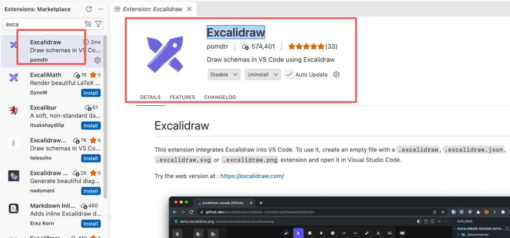

# 手稿

本目录是第 1 节到目前最新一节的 Excalidraw 手稿。用 VS Code 安装 Excalidraw 插件后，直接点开 `.excalidraw` 文件即可查看。

## 安装插件

1. 打开 VS Code，进入扩展市场（macOS `Cmd+Shift+X`，Windows / Linux `Ctrl+Shift+X`）。
2. 搜索 `exca`。
3. 安装发布者是 **pomdtr** 的 **Excalidraw**，简介是 “Draw schemas in VS Code using Excalidraw”。搜索结果里有好几个同名插件，装红框里的这一份。



也可以在终端安装：

```bash
code --install-extension pomdtr.excalidraw
```

Cursor 的扩展市场是同一份，搜索并安装同一个插件。

## 查看

装好后，点开下面任一文件。

| 文件 | 内容 |
|---|---|
| `lesson-1.excalidraw` | 第 1 节 |
| `lesson-2.excalidraw` | 第 2 节 |
| `lesson-3.excalidraw` | 第 3 节。这一节只画了开场的「01 课程目标」 |
| `lesson-4.excalidraw` | 第 4 节 |
| `lesson-5.excalidraw` | 第 5 节 |
| `lesson-6.excalidraw` | 离生产闭环还差什么 |
| `lesson-7.excalidraw` | 服务端和客户端。两种架构、SSE、一次对话怎么走、每个文件做什么 |
| `persistence.excalidraw` | 持久化。内存和硬盘、SQLite、Drizzle |
| `sampling.excalidraw` | 采样和思考。温度、草稿、档位 |
